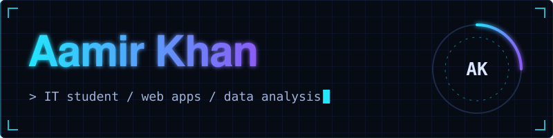
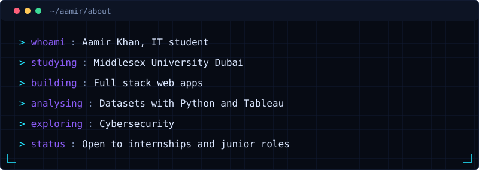
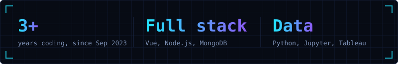
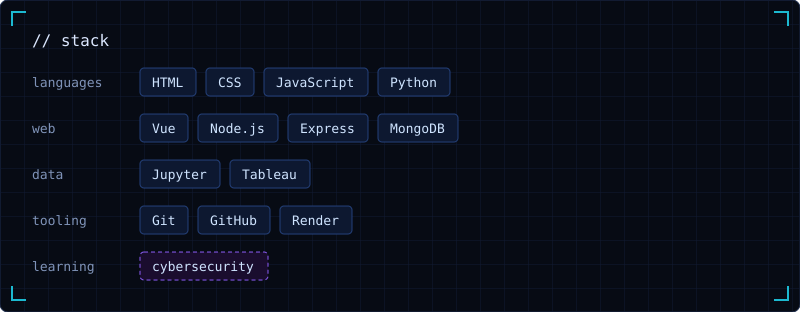

[Repositories](https://github.com/AamirK191105?tab=repositories) • [Portfolio](https://aamirk191105.github.io) • [LinkedIn](https://www.linkedin.com/in/aamir-khan-611548293/) • [Email](mailto:aamirkhan191105@gmail.com)

<picture>
  <source media="(prefers-color-scheme: dark)" srcset="https://raw.githubusercontent.com/USERNAME/USERNAME/output/github-snake-dark.svg" />
  <source media="(prefers-color-scheme: light)" srcset="https://raw.githubusercontent.com/USERNAME/USERNAME/output/github-snake.svg" />
  
</picture>

